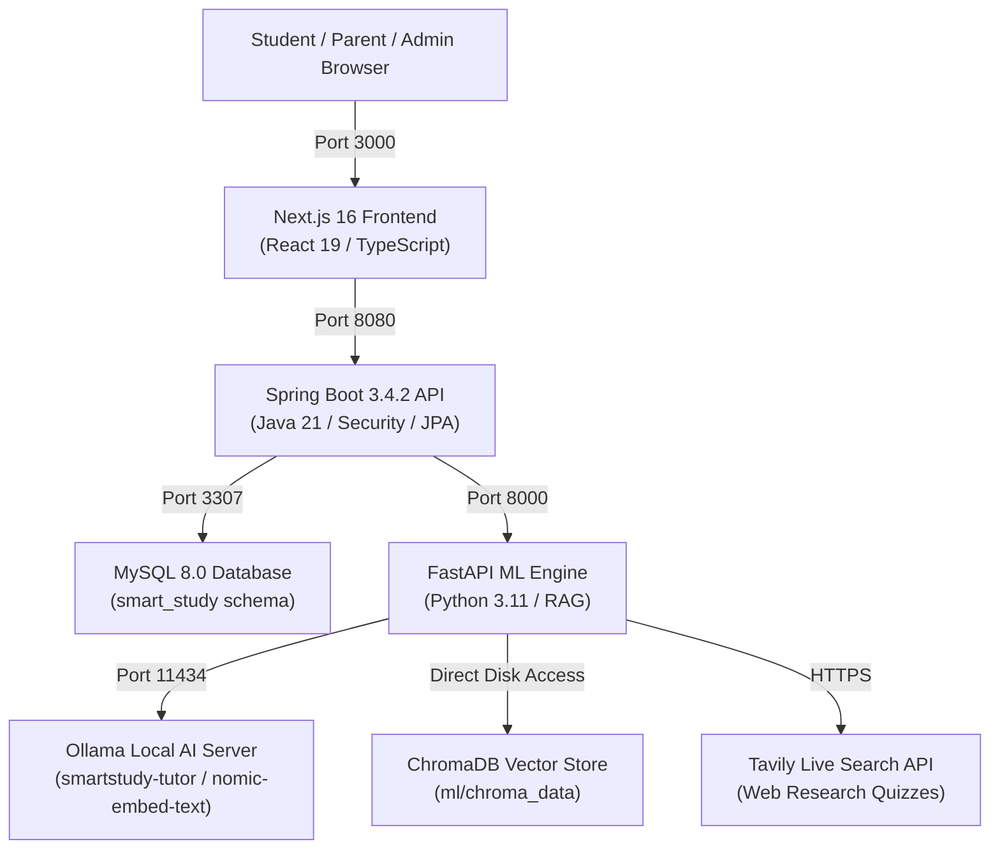

# Smart Study Portal — Complete Step-by-Step Run Guide

This document provides a comprehensive, production-grade guide to setting up, starting, and verifying all components of the **Smart Study Portal (Smart Edu)** on Windows, macOS, or Linux.

---

## 1. System Architecture & Service Ports

The platform runs as a distributed multi-service architecture communicating over localhost:



| Service | Port | Default Health URL | Technology |
| :--- | :--- | :--- | :--- |
| **Frontend Web App** | `3000` | `http://localhost:3000` | Next.js 16 (Turbopack), React 19, Tailwind CSS 4 |
| **Backend REST API** | `8080` | `http://localhost:8080/api/v1` | Spring Boot 3.4.2, Java 21, Spring Security, Flyway |
| **Machine Learning Engine** | `8000` | `http://localhost:8000/health` | FastAPI, Python 3.11, Uvicorn, LangChain, PyMuPDF |
| **Local AI Inference (Ollama)** | `11434`| `http://localhost:11434/api/tags` | Ollama (Local GPU / CPU inference), Qwen 2.5 Coder 1.5B |
| **Relational Database** | `3307` | `localhost:3307` | MySQL 8.0 Community Server (`smart_study` db) |
| **Vector Database** | N/A | Persistent directory | ChromaDB (`ml/chroma_data`) |

---

## 2. Prerequisites Checklist

Ensure the following tools are installed on your machine before running:

1. **Operating System:** Windows 10/11 (PowerShell), macOS, or Linux.
2. **Node.js:** `v20.9.0` or newer (Node.js 22 or 26 recommended). Verify: `node -v`
3. **Java Development Kit (JDK):** JDK 21. Verify: `java -version`
4. **Apache Maven:** Maven 3.9+ (`mvn` or `mvn.cmd`). Verify: `mvn -v`
5. **Python:** Python 3.11 or newer. Verify: `python --version`
6. **MySQL Server:** MySQL 8.0. (Default local datadir: `D:\Smart Edu\mysql-fresh-data` on port `3307`).
7. **Ollama:** Installed from [ollama.com](https://ollama.com). Verify: `ollama --version`
8. **Git:** Verify: `git --version`

---

## 3. Initial Setup (One-Time Execution)

Run these steps once after cloning the repository to install dependencies and configure models:

### Step 3.1: Environment File Configuration
In the project root (`D:\Smart Edu`), ensure `.env` is created from `.env.example`:
```powershell
Set-Location 'D:\Smart Edu'
if (-not (Test-Path .env)) { Copy-Item .env.example .env }
```

Ensure your `TAVILY_API_KEY` is set in `.env` (required for Live Web Research quizzes):
```env
TAVILY_API_KEY=tvly-your-api-key-here
```

### Step 3.2: Pull and Build Ollama Local AI Models
Start the Ollama application or run `ollama serve` in a terminal, then download the embedding and tutor base models:
```powershell
# 1. Pull the 768-dimensional embedding model for vector retrieval
ollama pull nomic-embed-text

# 2. Pull the high-efficiency code and reasoning model
ollama pull qwen2.5-coder:1.5b

# 3. Create the custom academic tutor model
Set-Location 'D:\Smart Edu'
ollama create smartstudy-tutor -f ml/Modelfile.tutor
```

Verify the models exist:
```powershell
ollama list
```
*(You should see `smartstudy-tutor`, `nomic-embed-text`, and `qwen2.5-coder:1.5b` listed).*

### Step 3.3: Install Python ML Dependencies
```powershell
Set-Location 'D:\Smart Edu\ml'
python -m venv .venv
.\.venv\Scripts\Activate.ps1
python -m pip install --upgrade pip
pip install -r requirements.txt
```

### Step 3.4: Install Frontend Node Modules
```powershell
Set-Location 'D:\Smart Edu\frontend'
npm install
```

---

## 4. How to Start the Project (Step-by-Step)

You can start the project using **Method A (Automated One-Click Script)** or **Method B (Separate Dedicated Terminals)**.

---

### Method A: Automated One-Click Startup (Recommended)

From the project root in an Administrator or standard PowerShell prompt:

```powershell
Set-Location 'D:\Smart Edu'
.\run-all.ps1
```

The script automatically detects whether ports are occupied and launches:
- **[1/4]** MySQL Server on port `3307`
- **[2/4]** FastAPI ML Engine on port `8000`
- **[3/4]** Spring Boot Backend on port `8080`
- **[4/4]** Next.js Frontend on port `3000`

---

### Method B: Manual Step-by-Step Startup (Dedicated Terminals)

To monitor individual service logs in real time, open 5 separate PowerShell terminal windows in the order shown below:

#### Terminal 1 — Ollama Server
If Ollama is already running as a Windows background taskbar app, you can skip this. Otherwise:
```powershell
ollama serve
```
*Health Check:* Open `http://127.0.0.1:11434/api/tags` in your browser.

#### Terminal 2 — MySQL 8.0 Server (Port 3307)
```powershell
& 'C:\Program Files\MySQL\MySQL Server 8.0\bin\mysqld.exe' `
  '--datadir=D:\Smart Edu\mysql-fresh-data' `
  --port=3307 --mysqlx=0 --bind-address=127.0.0.1 --shared-memory=OFF --named-pipe=OFF --console
```
*Expected log:* `ready for connections. Version: '8.0.xx' socket: '' port: 3307`

#### Terminal 3 — FastAPI Machine Learning Engine (Port 8000)
```powershell
Set-Location 'D:\Smart Edu\ml'
.\.venv\Scripts\Activate.ps1
python -m uvicorn app.main:app --host 127.0.0.1 --port 8000
```
*Expected log:* `Application startup complete. Uvicorn running on http://127.0.0.1:8000`  
*Health Check:* Open `http://127.0.0.1:8000/health`. Should return `{"status": "healthy"}`.

#### Terminal 4 — Spring Boot Backend API (Port 8080)
```powershell
Set-Location 'D:\Smart Edu\backend'
mvn.cmd spring-boot:run "-Dspring-boot.run.arguments=--spring.datasource.password=dev-password-change-me --spring.datasource.url=jdbc:mysql://localhost:3307/smart_study?createDatabaseIfNotExist=true&useSSL=false&allowPublicKeyRetrieval=true&serverTimezone=UTC --app.dev-seed-enabled=true"
```
*Expected log:* `Started SmartStudyApplication in X.XXX seconds (process running for X.XXX)`

#### Terminal 5 — Next.js Web Frontend (Port 3000)
```powershell
Set-Location 'D:\Smart Edu\frontend'
npm run dev
```
*Expected log:* `▲ Next.js 16.4.3 (Turbopack) - Local: http://localhost:3000`

---

## 5. Pre-Configured Demo Accounts

The database is seeded automatically on startup with three pre-configured accounts:

| Role | Email | Password | Access / Features |
| :--- | :--- | :--- | :--- |
| **Student** | `student@test.com` | `Password123!` | AI Tutor, Quizzes, Study Notes, Pomodoro Timer, Tasks |
| **Parent** | `parent@test.com` | `Password123!` | Linked Student Progress, Study Hours, Accuracy Audit Ledger |
| **Admin** | `admin@test.com` | `Password123!` | System Health, Tenant Overview, Academic Taxonomy Ingestion |

You can also use the **One-Click Demo Accounts** button on the `/login` screen to instantly populate credentials.

---

## 6. Verifying System Health & Functionality

Once all services are up, open your web browser:

1. **Public Landing Page:** Visit `http://localhost:3000`.
   - Verify the wide-stretched layout and smooth navigation.
   - Verify the Interactive Active Recall Quiz preview.
2. **Sign In:** Go to `http://localhost:3000/login`.
   - Sign in as `student@test.com` with `Password123!`.
   - You will be redirected to the Student Dashboard.
3. **AI Tutor Test:**
   - Navigate to `http://localhost:3000/ai-tutor`.
   - Select an existing note or upload a PDF (e.g. `Python – BDS306B.pdf`).
   - Ask: `"Summarize key concepts from my notes."`
   - Verify the tutor returns a grounded explanation with document citations.
4. **Quiz Engine Test:**
   - Navigate to `http://localhost:3000/quizzes`.
   - Click **Live Web Research**, enter topic `"Cricket"`, count `5`, and generate.
   - Verify questions display real web sources (Wikipedia, Britannica) and can be submitted.

### Automated Regression & Integration Test Suite
To verify all 19 system integration tests end-to-end, run:
```powershell
Set-Location 'D:\Smart Edu'
.\ml\.venv\Scripts\python.exe scratch/test_complete_integration_suite.py
```
*(Expected: `Total: 19 | PASSED: 19 | FAILED: 0 | BLOCKED: 0`)*

---

## 7. How to Stop the Services

- **Manual Startup:** Press `Ctrl + C` in each of the 5 terminal windows.
- **PowerShell Process Termination:** If background processes need to be terminated:
  ```powershell
  Stop-Process -Name "java", "uvicorn", "mysqld" -Force -ErrorAction SilentlyContinue
  ```

---

## 8. Common Troubleshooting & FAQs

### Q1: Port 8080 or 8000 is already in use
Check what process is listening on the port:
```powershell
Get-NetTCPConnection -LocalPort 8080 -ErrorAction SilentlyContinue | Select-Object OwningProcess
Get-NetTCPConnection -LocalPort 8000 -ErrorAction SilentlyContinue | Select-Object OwningProcess
```
Kill the holding process:
```powershell
Stop-Process -Id <PID> -Force
```

### Q2: MySQL "Access Denied" or Database Connection Error
Ensure the Spring Boot launcher arguments specify the local port `3307` and credentials:
```powershell
--spring.datasource.url=jdbc:mysql://localhost:3307/smart_study?createDatabaseIfNotExist=true&useSSL=false&allowPublicKeyRetrieval=true&serverTimezone=UTC
--spring.datasource.password=dev-password-change-me
```

### Q3: AI Tutor returns "Ollama connection refused"
Ensure Ollama is running and listening on port `11434`:
```powershell
curl http://127.0.0.1:11434/api/tags
```
If not running, launch `ollama serve`.

### Q4: "Rate limit exceeded" during Quiz Generation
If your OpenRouter or external cloud API key is exhausted, the FastAPI engine automatically routes inference to the local Ollama GPU model `smartstudy-tutor:latest` with zero delays or rate limits.

---

## 9. Method C: Running via Docker Compose

If you have Docker Desktop installed, you can launch the containerized application stack:

```powershell
Set-Location 'D:\Smart Edu'
docker compose up --build
```

- Web App: `http://localhost:3000`
- Backend API: `http://localhost:8080/api/v1`
- ML Engine: `http://localhost:8000/health`
- Database: `localhost:3306`

To shut down containers:
```powershell
docker compose down
```

