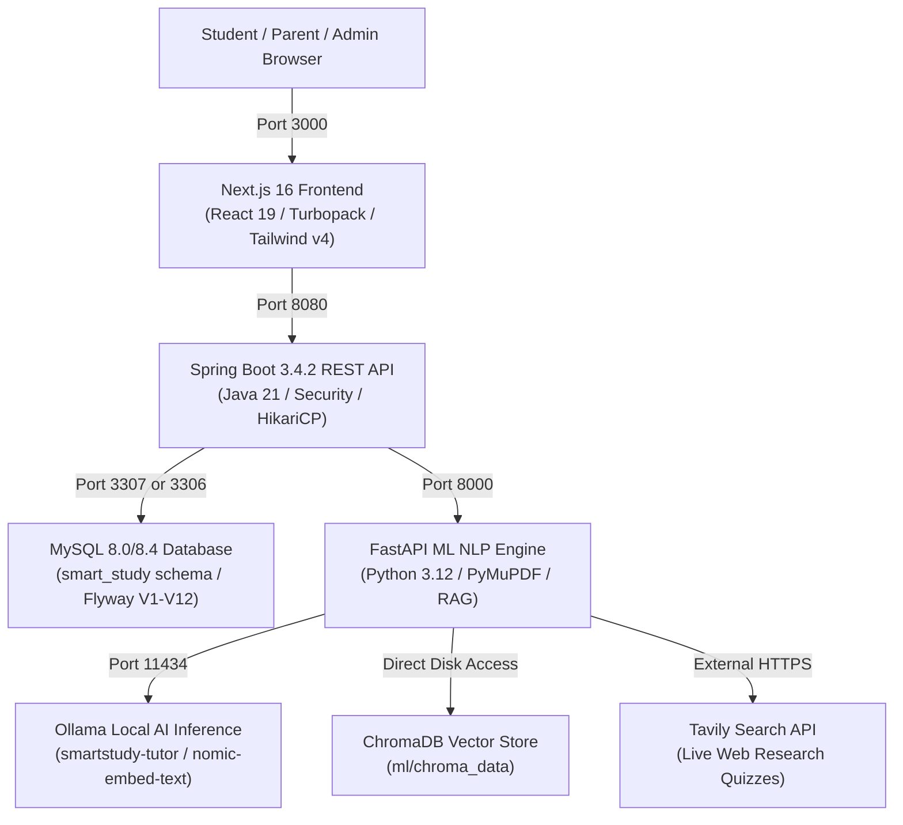

# Smart Study Portal (Smart Edu) — Step-by-Step Run & Execution Guide

**Version:** 1.0.0 (Production Hardened)  
**Workspace Root:** `D:\Smart Edu`  
**GitHub Repository:** [https://github.com/adityakonnur228-sudo/Smart-Edu](https://github.com/adityakonnur228-sudo/Smart-Edu)  
**Latest Release Commit:** `14ef593`  

---

## 📑 Table of Contents

1. [Architecture & Port Distribution](#1-architecture--port-distribution)
2. [Prerequisites & System Requirements](#2-prerequisites--system-requirements)
3. [First-Time Setup (One-Time Execution)](#3-first-time-setup-one-time-execution)
   - [3.1 Configure Environment Variables](#31-configure-environment-variables)
   - [3.2 Pull & Configure Ollama Local AI Models](#32-pull--configure-ollama-local-ai-models)
   - [3.3 Set Up Python ML Virtual Environment](#33-set-up-python-ml-virtual-environment)
   - [3.4 Install Frontend Dependencies](#34-install-frontend-dependencies)
   - [3.5 Compile Spring Boot Backend](#35-compile-spring-boot-backend)
4. [Database Initialization (MySQL)](#4-database-initialization-mysql)
5. [Starting the Application](#5-starting-the-application)
   - [Method 1: Automated One-Click Script (Recommended)](#method-1-automated-one-click-script-recommended)
   - [Method 2: Manual Multi-Terminal Startup](#method-2-manual-multi-terminal-startup)
   - [Method 3: Docker Compose Containerization](#method-3-docker-compose-containerization)
6. [Pre-Configured Demo Login Accounts](#6-pre-configured-demo-login-accounts)
7. [System Verification & Feature Smoke Testing](#7-system-verification--feature-smoke-testing)
8. [Automated Test Suites](#8-automated-test-suites)
9. [Stopping Services & Clean Shutdown](#9-stopping-services--clean-shutdown)
10. [Troubleshooting & Diagnostic FAQ](#10-troubleshooting--diagnostic-faq)

---

## 1. Architecture & Port Distribution

Smart Study Portal is a distributed microservices platform that runs across five local processes communicating over localhost:



| Service | Host & Port | Health Probe / Inspection URL | Role |
| :--- | :--- | :--- | :--- |
| **Frontend Web App** | `http://localhost:3000` | `http://localhost:3000` | User Interface, 3D graphics, state management |
| **Backend REST API** | `http://localhost:8080` | `http://localhost:8080/api/v1/auth/me` | Business logic, authentication, Flyway migrations |
| **NLP & ML Engine** | `http://localhost:8000` | `http://localhost:8000/health/live` | Document parsing, semantic chunking, RAG retrieval |
| **Ollama Local AI** | `http://localhost:11434`| `http://localhost:11434/api/tags` | Offline LLM inference and vector embeddings |
| **MySQL Database** | `localhost:3307` (or `3306`) | Native TCP connection | Relational transactional persistence (`smart_study`) |
| **ChromaDB** | Local file storage | `ml/chroma_data/` | High-dimensional embedding vector store |

---

## 2. Prerequisites & System Requirements

Before running the application, ensure your workstation satisfies the following software requirements:

| Tool | Minimum Version | Recommended Version | Verification Command |
| :--- | :--- | :--- | :--- |
| **Operating System** | Windows 10, macOS 12+, Linux | Windows 11 (PowerShell) | `Get-CimInstance Win32_OperatingSystem` |
| **Java Development Kit** | OpenJDK 21 LTS | Eclipse Temurin 21.0.6+ | `java -version` |
| **Apache Maven** | Maven 3.9.0+ | Maven 3.9.9 (`mvn.cmd`) | `mvn -v` |
| **Node.js** | Node.js 20.9.0 LTS | Node.js 22 LTS or 24 LTS | `node -v` |
| **npm** | npm 10.0+ | npm 10.9+ | `npm -v` |
| **Python** | Python 3.11 | Python 3.12 (with `venv` & `pip`) | `python --version` |
| **MySQL Server** | MySQL Community 8.0 | MySQL 8.0.36 or 8.4 LTS | `mysqld --version` |
| **Ollama** | Latest | Installed from [ollama.com](https://ollama.com) | `ollama --version` |
| **Git** | Git 2.40+ | Latest Git for Windows | `git --version` |

> [!TIP]
> **PowerShell Execution Policy:** On Windows, if running `.ps1` scripts throws a permissions error, run this one-time command in PowerShell:
> ```powershell
> Set-ExecutionPolicy -Scope Process RemoteSigned
> ```

---

## 3. First-Time Setup (One-Time Execution)

Follow these initial steps once after cloning the repository.

### 3.1 Configure Environment Variables
Open a PowerShell terminal in the repository root (`D:\Smart Edu`):

```powershell
Set-Location 'D:\Smart Edu'

# Copy environment template if .env does not exist
if (-not (Test-Path .env)) {
    Copy-Item .env.example .env
}
```

Verify the key properties in `.env`:
* `SPRING_DATASOURCE_URL=jdbc:mysql://localhost:3307/smart_study?createDatabaseIfNotExist=true&useSSL=false&allowPublicKeyRetrieval=true&serverTimezone=UTC`
* `SPRING_DATASOURCE_PASSWORD=dev-password-change-me`
* `TAVILY_API_KEY=tvly-...` (Optional: set for live web-grounded quizzes)

---

### 3.2 Pull & Configure Ollama Local AI Models
Smart Study Portal uses local AI models for vector embeddings and document tutoring. 

1. Ensure the Ollama background daemon is running:
   ```powershell
   ollama serve
   ```
2. In a second terminal, download the required embedding and reasoning models:
   ```powershell
   # 1. High-dimensional vector embedding model
   ollama pull nomic-embed-text

   # 2. Base lightweight reasoning model
   ollama pull qwen2.5-coder:1.5b

   # (Optional alternative base model)
   ollama pull llama3.2
   ```
3. Build the custom academic tutor model using the project Modelfile:
   ```powershell
   Set-Location 'D:\Smart Edu'
   ollama create smartstudy-tutor -f ml/Modelfile.tutor
   ```
4. Verify the models are installed:
   ```powershell
   ollama list
   ```
   *Expected output includes: `smartstudy-tutor:latest`, `nomic-embed-text:latest`, `qwen2.5-coder:1.5b`.*

---

### 3.3 Set Up Python ML Virtual Environment
```powershell
Set-Location 'D:\Smart Edu\ml'

# Create dedicated virtual environment
python -m venv .venv

# Activate virtual environment
.\.venv\Scripts\Activate.ps1

# Upgrade pip and install all NLP dependencies
python -m pip install --upgrade pip
pip install -r requirements.txt
```

---

### 3.4 Install Frontend Dependencies
The frontend uses Next.js 16.4.3, React 19.3.0, `@react-three/fiber` 9.1.4, and `@react-three/drei` 10.7.9.

```powershell
Set-Location 'D:\Smart Edu\frontend'
npm install
```

---

### 3.5 Compile Spring Boot Backend
Verify that Maven can resolve all dependencies and build the backend JAR:

```powershell
Set-Location 'D:\Smart Edu\backend'
mvn.cmd clean compile -DskipTests
```

---

## 4. Database Initialization (MySQL)

Smart Study Portal manages its database tables through **Flyway migrations** (`V1` through `V12`). The application will create all tables automatically on first launch.

You can run MySQL in one of two ways:

### Option A: Local Dedicated Instance (Port 3307 — Default Dev Profile)
The project includes a pre-configured local datadir (`D:\Smart Edu\mysql-fresh-data`) on port `3307`. To start it:
```powershell
& 'C:\Program Files\MySQL\MySQL Server 8.0\bin\mysqld.exe' `
  '--datadir=D:\Smart Edu\mysql-fresh-data' `
  --port=3307 --mysqlx=0 --bind-address=127.0.0.1 --shared-memory=OFF --named-pipe=OFF --console
```

### Option B: System MySQL Service (Port 3306)
If you prefer your system-wide MySQL service on standard port `3306`:
1. Connect to MySQL via command line:
   ```powershell
   mysql -u root -p
   ```
2. Create the UTF8MB4 database:
   ```sql
   CREATE DATABASE IF NOT EXISTS smart_study CHARACTER SET utf8mb4 COLLATE utf8mb4_unicode_ci;
   EXIT;
   ```
3. Update the port in your startup arguments or `.env` to `3306`.

---

## 5. Starting the Application

### Method 1: Automated One-Click Script (Recommended)

From the project root in PowerShell:

```powershell
Set-Location 'D:\Smart Edu'
.\run-all.ps1
```

**What the script does:**
1. Checks port `3307` $\rightarrow$ Starts dedicated MySQL 8.0 server if not already running.
2. Checks port `8000` $\rightarrow$ Starts FastAPI ML Engine in the background.
3. Checks port `8080` $\rightarrow$ Launches Spring Boot API with dev seed enabled.
4. Checks port `3000` $\rightarrow$ Launches Next.js frontend with Turbopack.

---

### Method 2: Manual Multi-Terminal Startup

If you want to view real-time log output from each microservice, open **5 separate PowerShell terminals**:

#### Terminal 1 — Ollama Daemon
```powershell
ollama serve
```
*Health Check:* Open `http://localhost:11434/api/tags` in browser.

#### Terminal 2 — MySQL Server (Port 3307)
```powershell
& 'C:\Program Files\MySQL\MySQL Server 8.0\bin\mysqld.exe' `
  '--datadir=D:\Smart Edu\mysql-fresh-data' `
  --port=3307 --mysqlx=0 --bind-address=127.0.0.1 --shared-memory=OFF --named-pipe=OFF --console
```
*Expected log:* `ready for connections. Version: '8.0.xx' port: 3307`

#### Terminal 3 — FastAPI ML Engine (Port 8000)
```powershell
Set-Location 'D:\Smart Edu\ml'
.\.venv\Scripts\Activate.ps1
python -m uvicorn app.main:app --host 127.0.0.1 --port 8000
```
*Expected log:* `Application startup complete. Uvicorn running on http://127.0.0.1:8000`  
*Health Check:* Open `http://127.0.0.1:8000/health/live` (returns `{"status": "healthy"}`).

#### Terminal 4 — Spring Boot Backend API (Port 8080)
```powershell
Set-Location 'D:\Smart Edu\backend'
mvn.cmd spring-boot:run "-Dspring-boot.run.arguments=--spring.datasource.password=dev-password-change-me --spring.datasource.url=jdbc:mysql://localhost:3307/smart_study?createDatabaseIfNotExist=true&useSSL=false&allowPublicKeyRetrieval=true&serverTimezone=UTC --app.dev-seed-enabled=true"
```
*Expected log:* `Started SmartStudyApplication in X.XXX seconds`

#### Terminal 5 — Next.js Frontend (Port 3000)
```powershell
Set-Location 'D:\Smart Edu\frontend'
npm run dev
```
*Expected log:* `▲ Next.js 16.4.3 (Turbopack) - Local: http://localhost:3000`

---

### Method 3: Docker Compose Containerization

If you have Docker Desktop running:

```powershell
Set-Location 'D:\Smart Edu'
docker compose up --build
```

To stop:
```powershell
docker compose down
```

---

## 6. Pre-Configured Demo Login Accounts

The backend database seeds three pre-configured accounts on startup (`--app.dev-seed-enabled=true`):

| Role | Email | Password | Access Rights & Modules |
| :--- | :--- | :--- | :--- |
| **Student** | `student@test.com` | `Password123!` | Dashboard, AI Tutor, Materials, Quizzes, Flashcards, Focus Mode, Analytics |
| **Parent** | `parent@test.com` | `Password123!` | Privacy-Preserving Parent Portal, linked student study hours, accuracy ledger |
| **Admin** | `admin@test.com` | `Password123!` | Admin Portal, JVM memory telemetry, thread pool stats, user governance |

> [!NOTE]
> On the `/login` page, you can click the **One-Click Demo Accounts** button to populate credentials instantly.

---

## 7. System Verification & Feature Smoke Testing

Once all processes are running, verify the platform in your browser:

### 1. Landing Page
* URL: `http://localhost:3000`
* Check: Wide responsive 3D hero scene, feature navigation, interactive quiz teaser.

### 2. Sign In
* URL: `http://localhost:3000/login`
* Sign in with `student@test.com` / `Password123!`.
* Check: Successfully redirects to `http://localhost:3000/dashboard` without authentication errors.

### 3. Source-Grounded AI Tutor
* URL: `http://localhost:3000/ai-tutor`
* Upload a lecture note or textbook PDF (e.g., `Python – BDS306B.pdf`).
* Ask: `"Summarize the key concepts from Module 1."`
* Check: Grounded answer streams back with clickable document citation badges (`[Doc: ...]`).

### 4. Dynamic Quizzes
* URL: `http://localhost:3000/quizzes`
* Generate a quiz from an uploaded note or choose **Live Web Research** (e.g., topic: `"Operating Systems"`).
* Complete questions and submit; verify score, explanations, and review ledger.

### 5. Spaced Repetition Flashcards
* URL: `http://localhost:3000/flashcards`
* Click a card to flip and rate your recall quality (0 to 5).
* Check: Next review interval updates dynamically per the SuperMemo SM-2 algorithm.

### 6. Cognitive Focus Mode
* URL: `http://localhost:3000/focus`
* Start a 25-minute Pomodoro or stopwatch session. Toggle ambient sound (Alpha Waves / Pink Noise).
* Stop session; verify saved minutes sync to the database.

### 7. Analytics Dashboard
* URL: `http://localhost:3000/analytics`
* Check: Verified focus minutes appear on the 7-day Asia/Kolkata rolling chart.

---

## 8. Automated Test Suites

Smart Study Portal includes automated verification across all layers:

### 1. Frontend Build & TypeScript Check
```powershell
Set-Location 'D:\Smart Edu\frontend'
npm run typecheck
npm run lint
npm run build
```

### 2. Backend Unit & Integration Tests (13 Suites)
```powershell
Set-Location 'D:\Smart Edu\backend'
mvn.cmd test
```

### 3. ML NLP & Probes Test Suite (17 Tests)
```powershell
Set-Location 'D:\Smart Edu\ml'
.\.venv\Scripts\python.exe -m unittest tests/test_service.py
.\.venv\Scripts\python.exe -m unittest tests/test_tutor_quality.py
```

### 4. End-to-End Playwright Authentication Suite (14 Tests)
```powershell
Set-Location 'D:\Smart Edu'
node frontend/test_full_auth_suite.js
```
*(Validates lockdown, login redirect, dual cookies, token boundary enforcement, rotation, session persistence, module navigation, RBAC, tenant isolation, and revocation on logout).*

---

## 9. Stopping Services & Clean Shutdown

### Method A: Automated Shutdown Script
In PowerShell:
```powershell
Set-Location 'D:\Smart Edu'
.\stop-all.ps1
```

### Method B: Manual Shutdown
* In each terminal window running a service, press `Ctrl + C`.
* To forcefully terminate all background processes:
  ```powershell
  Stop-Process -Name "mysqld", "uvicorn", "java", "node" -Force -ErrorAction SilentlyContinue
  ```

---

## 10. Troubleshooting & Diagnostic FAQ

### Q1: Port 8080, 8000, 3000, or 3307 is already in use
Find the process holding the port and terminate it:
```powershell
# Find Process ID (PID)
Get-NetTCPConnection -LocalPort 8080 -ErrorAction SilentlyContinue | Select-Object OwningProcess

# Terminate process by PID
Stop-Process -Id <PID> -Force
```

### Q2: Browser displays `ApiError: Authentication required`
* **Cause:** Expired session or missing token in browser storage.
* **Fix:** Clear cookies for `localhost` in browser DevTools $\rightarrow$ navigate to `/login` $\rightarrow$ sign in with `student@test.com` / `Password123!`.

### Q3: ML Service `/health` returns `status: "degraded"`
* **Cause:** The local Ollama daemon is offline or models are not yet pulled.
* **Fix:**
  1. Open a terminal and run `ollama serve`.
  2. Verify: `ollama list`. If empty, pull models: `ollama pull nomic-embed-text` and `ollama pull qwen2.5-coder:1.5b`.
  3. Query the liveness probe: `curl http://localhost:8000/health/live` (returns `200 OK`).

### Q4: MySQL `CommunicationsException` or `Access denied for user`
* Ensure your connection arguments match your MySQL port (`3307` for dedicated local instance or `3306` for system service).
* Default dev password is `dev-password-change-me`.

### Q5: Frontend `npm ci` fails with `ERESOLVE`
* The project runs **React 19.3.0** with `@react-three/fiber@^9.1.4` and `@react-three/drei@^10.7.9`.
* Always use `npm install` or ensure you are running on Node.js 22 LTS or newer. Do not use `--legacy-peer-deps` or downgrade React.
