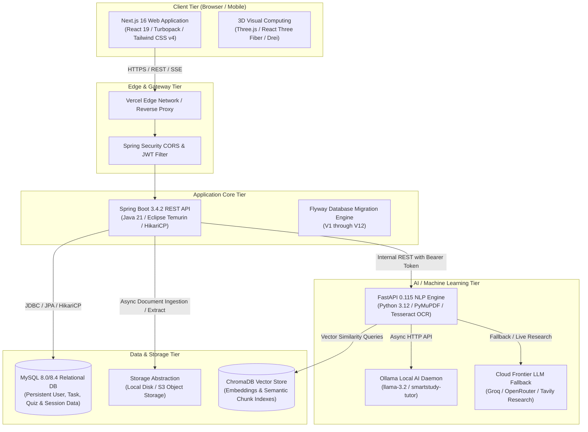
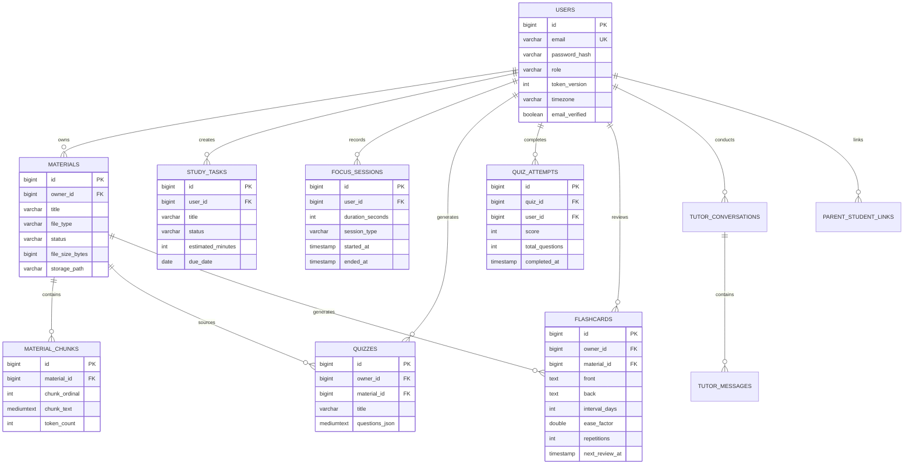
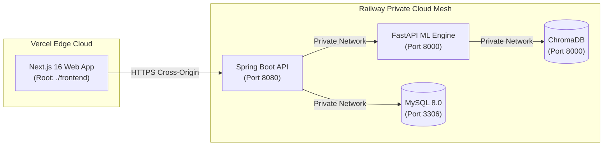

# Smart Study Portal (Smart Edu) — Complete System Architecture & Master Guide

**Version:** 1.0.0 (Production Hardened)  
**Latest Verified Release Commit:** `2dfda6a` / `8e0f7a8`  
**Repository:** [https://github.com/adityakonnur228-sudo/Smart-Edu](https://github.com/adityakonnur228-sudo/Smart-Edu)  
**Target Environments:** Local Development (`localhost`), Cloud Staging & Production (Vercel Frontend + Railway Cloud Services)  

---

## 📑 Table of Contents

1. [Project Overview & Educational Philosophy](#1-project-overview--educational-philosophy)
2. [Full-Stack Architecture & Microservices Topology](#2-full-stack-architecture--microservices-topology)
3. [Technology Stack & Dependency Matrix](#3-technology-stack--dependency-matrix)
4. [In-Depth Functional Modules](#4-in-depth-functional-modules)
   - [4.1 Authentication, Token Lifecycle & RBAC](#41-authentication-token-lifecycle--rbac)
   - [4.2 Document Ingestion & Vector Indexing Engine](#42-document-ingestion--vector-indexing-engine)
   - [4.3 Source-Grounded Conversational AI Tutor (RAG)](#43-source-grounded-conversational-ai-tutor-rag)
   - [4.4 Dynamic Quizzes & Real-Time Assessment Engine](#44-dynamic-quizzes--real-time-assessment-engine)
   - [4.5 Spaced Repetition Flashcards (SuperMemo SM-2)](#45-spaced-repetition-flashcards-supermemo-sm-2)
   - [4.6 Study Task Management & Intelligent Minute Allocation](#46-study-task-management--intelligent-minute-allocation)
   - [4.7 Cognitive Focus Mode (Stopwatch, Pomodoro & Audio Zen)](#47-cognitive-focus-mode-stopwatch-pomodoro--audio-zen)
   - [4.8 Progress Analytics & Telemetry Normalization](#48-progress-analytics--telemetry-normalization)
   - [4.9 Privacy-Preserving Parent Portal](#49-privacy-preserving-parent-portal)
   - [4.10 Admin Portal & JVM Runtime Diagnostics](#410-admin-portal--jvm-runtime-diagnostics)
5. [Database Architecture & Flyway Evolution](#5-database-architecture--flyway-evolution)
6. [Security Architecture & Multi-Environment Cookie Matrix](#6-security-architecture--multi-environment-cookie-matrix)
7. [Comprehensive REST API Reference](#7-comprehensive-rest-api-reference)
8. [Step-by-Step Setup, Installation & Run Guide](#8-step-by-step-setup-installation--run-guide)
9. [Automated Testing & Verification Suite](#9-automated-testing--verification-suite)
10. [Production Cloud Deployment Manual (Vercel + Railway)](#10-production-cloud-deployment-manual-vercel--railway)
11. [Complete Environment Variables Catalog](#11-complete-environment-variables-catalog)
12. [Troubleshooting & Diagnostic Runbook](#12-troubleshooting--diagnostic-runbook)

---

## 1. Project Overview & Educational Philosophy

The **Smart Study Portal** is an enterprise-grade, full-stack educational operating system designed for self-directed students, educators, and parents. It transforms unstructured academic materials (PDFs, DOCX, PPTX, XLSX, TXT, Markdown) into an active, closed-loop learning rhythm.

### 1.1 The Core Problems It Solves
1. **Information Overload:** Students are inundated with 100-page textbooks and complex slide decks. The portal ingests, semantically segments, and extracts essential concepts automatically.
2. **Illusion of Competence:** Passive re-reading creates a superficial sense of understanding. The portal enforces active recall via factual entity quizzes, conversational challenge prompts, and spaced repetition flashcards.
3. **Planning Paralysis:** Students struggle to balance daily study minutes across subjects. The portal's task engine calculates real-time minute allocations based on urgency, difficulty, and verified focus history.
4. **Distraction & Cognitive Drift:** The focus mode captures verified, drift-free study sessions in the student's exact timezone, correlating actual study effort with quiz mastery and subject retention.

### 1.2 Core Pillars
* **Strict Source Grounding:** AI tutor responses cite exact document chunks with verifiable text quotes.
* **Local-First Privacy:** Powered by local Ollama LLMs and ChromaDB vector embeddings, protecting student learning data from third-party vendor harvesting.
* **Dual-Transport Resilience:** Hardened authentication supporting modern HttpOnly SameSite cookies and decoupled Authorization Bearer headers for cross-origin cloud topologies.

---

## 2. Full-Stack Architecture & Microservices Topology

The platform operates as a decoupled microservices architecture composed of four core tiers:



---

## 3. Technology Stack & Dependency Matrix

| Component | Technology | Version | Purpose |
| :--- | :--- | :--- | :--- |
| **Frontend Framework** | Next.js (App Router, Turbopack) | **16.4.3** | Server-side rendering, client components, routing |
| **Frontend Runtime** | React / React DOM | **19.3.0** | Interactive component tree, modern concurrent mode |
| **3D Graphics** | Three.js / Fiber / Drei | **0.170 / 9.1.4 / 10.7.9** | Interactive 3D hero canvas, knowledge sphere, zen scene |
| **Styling & Icons** | Tailwind CSS / Lucide React | **4.0.0 / 1.47.0** | Responsive Midnight Indigo & Electric Periwinkle design |
| **Data Fetching** | TanStack React Query | **5.0.0** | Cached state management, optimistic updates |
| **Backend Framework** | Spring Boot | **3.4.2** | Enterprise REST API, security, scheduling, data persistence |
| **Backend Runtime** | OpenJDK (Eclipse Temurin) | **Java 21 LTS** | High-throughput virtual threads, modern Java syntax |
| **Database Migration** | Flyway Core & MySQL | **10.x** | Versioned, idempotent relational database schema evolution |
| **Relational DB** | MySQL Server | **8.0 / 8.4 LTS** | ACID transactional storage with UTF8MB4 collation |
| **NLP & AI Engine** | FastAPI / Uvicorn | **0.115 / 0.34** | High-performance asynchronous document NLP & RAG |
| **Python Runtime** | CPython | **3.12 LTS** | Python execution environment |
| **Document Parsing** | PyMuPDF (fitz), python-docx, openpyxl, python-pptx | **1.25 / 1.1 / 3.1** | High-fidelity parsing of PDFs, Word, Excel, and slides |
| **Vector Database** | ChromaDB | **0.5.0+** | Embedding persistence and semantic vector search |
| **Local LLM Server** | Ollama | **Latest** | Offline local model inference (`smartstudy-tutor`, `llama3.2`) |
| **Cloud AI Fallback** | Groq / OpenRouter / Tavily | **APIs** | Frontier model fallback and live grounded web research |

---

## 4. In-Depth Functional Modules

### 4.1 Authentication, Token Lifecycle & RBAC
The authentication architecture implements a **Dual-Transport Defense-in-Depth** model:
* **Token Segregation:**
  - **Access Token (1 Hour TTL):** Carries `role` (`STUDENT`, `PARENT`, `ADMIN`), database `token_version`, and claim `token_type: "access"`.
  - **Refresh Token (7 Days TTL):** Carries database `token_version`, a unique cryptographic UUID `jti`, and claim `token_type: "refresh"`. Strictly omits authorization roles.
* **Token Type Boundary Enforcement:**
  - `JwtFilter` validates incoming requests to general API endpoints. If an incoming token has `token_type: "refresh"`, authorization is immediately rejected (`HTTP 401/403`).
  - `/api/v1/auth/refresh` strictly rejects access tokens, requiring `token_type == "refresh"`.
* **Single-Use Refresh Token Rotation:** Every call to `/auth/refresh` invalidates the submitted refresh token and issues a newly rotated refresh token along with a fresh access token.
* **Instant Revocation on Active Logout:** Invoking `/api/v1/auth/logout` atomically increments `user.token_version` in MySQL, immediately and synchronously invalidating all existing access and refresh tokens across all active sessions.

### 4.2 Document Ingestion & Vector Indexing Engine
* **Supported Formats:** PDF (`.pdf`), Microsoft Word (`.docx`), Microsoft PowerPoint (`.pptx`), Microsoft Excel (`.xlsx`, `.xlsm`), Comma-Separated Values (`.csv`), Plain Text (`.txt`), and Markdown (`.md`).
* **Semantic Chunking:** Text is broken down using a target chunk size of 600 tokens with an 80-token overlap, preserving semantic paragraph boundaries.
* **Vector Indexing:** Chunks are embedded and indexed in ChromaDB collections segmented by subject and material ID, enabling millisecond similarity search.
* **Storage Abstraction:** File binaries are managed via `StorageService`, supporting local directory storage or S3-compatible cloud object buckets.

### 4.3 Source-Grounded Conversational AI Tutor (RAG)
* **Grounded Retrieval:** Combines lexical candidate matching with vector embeddings to extract the most relevant passage chunks.
* **Verifiable Citations:** Responses cite exact chunks (`[Doc: Notes.pdf, Section 3]`) and provide clickable source references.
* **Academic Curriculum Isolation:** Incorporates subject canonicalization (e.g., VTU 2022 Scheme engineering modules) to ensure computer science questions retrieve content strictly from the relevant subject domain.
* **Conversation Memory:** Multi-turn conversational context is maintained within the `tutor_conversations` and `tutor_messages` tables.

### 4.4 Dynamic Quizzes & Real-Time Assessment Engine
* **Multi-Modal Generation:**
  1. **Material-Grounded Quizzes:** Generates multiple-choice and conceptual questions directly from ingested student documents.
  2. **Topic-Based Quizzes:** Synthesizes structured quizzes for specified academic topics.
  3. **Live Web-Grounded Quizzes:** Incorporates real-time external research using Tavily Search API.
  4. **Encyclopedic Offline Fallback:** When internet and LLM services are offline, uses deterministic academic knowledge bases.
* **Interactive Quiz Runner:** Full-screen test interface supporting option selection, instant scoring, answer explanations, and mastery tracking.

### 4.5 Spaced Repetition Flashcards (SuperMemo SM-2)
* **Algorithmic Scheduling:** Employs the SuperMemo SM-2 spaced repetition algorithm to compute optimal review intervals:
  - **Repetition Count ($n$):** Tracks consecutive successful recalls.
  - **Ease Factor ($EF$):** Dynamically adjusted between 1.30 and 2.50 based on user rating (0 to 5).
  - **Interval ($I_n$):** $I_1 = 1 \text{ day}$, $I_2 = 6 \text{ days}$, $I_n = I_{n-1} \times EF$.
* **Automatic Term Extraction:** Generates structured flashcards automatically from bold terms, key definitions, and formula patterns in uploaded notes.

### 4.6 Study Task Management & Intelligent Minute Allocation
* **Dynamic Time Allocation:** Dynamically computes daily recommended study minutes per task based on target exam date, task difficulty, and remaining work.
* **Kanban & List Views:** Full task lifecycle management (`TODO`, `IN_PROGRESS`, `DONE`) with priority tagging and estimated duration tracking.

### 4.7 Cognitive Focus Mode (Stopwatch, Pomodoro & Audio Zen)
* **Drift-Free Precision:** Utilizes HTML5 Web Worker intervals and timestamp delta calculations to eliminate JavaScript timer drift caused by background tab throttling.
* **Modes:** Standard incremental stopwatch and customizable Pomodoro intervals (25m study / 5m break).
* **Audio Synthesis:** Client-side Web Audio API synthesizer generates ambient focus frequencies (binaural alpha waves, pink noise, rain sounds) without external network bandwidth.

### 4.8 Progress Analytics & Telemetry Normalization
* **Asia/Kolkata Timezone Normalization:** All focus session timestamps are converted to the student's local timezone to eliminate UTC day-boundary shifting.
* **Weekly Distribution Chart:** Visualizes daily study time across the 7-day rolling window.
* **Subject Mastery:** Correlates focus time, flashcard review quality, and quiz performance to compute a 0–100% subject proficiency score.

### 4.9 Privacy-Preserving Parent Portal
* **One-Way Secure Linkage:** Parents connect to a student account using a unique, short-lived 6-character linking code generated by the student.
* **Aggregate Visibility:** Parents view weekly study minutes, task completion rates, and subject engagement trends without reading private tutor chats or personal notes.

### 4.10 Admin Portal & JVM Runtime Diagnostics
* **System Telemetry:** Real-time JVM memory allocation (heap/non-heap), active thread count, CPU load, and database connection pool statistics.
* **User & Content Management:** View registered user accounts, role allocations, uploaded document counts, and system storage consumption.

---

## 5. Database Architecture & Flyway Evolution

The relational database uses **MySQL 8.0/8.4** managed by **Flyway migrations** (`backend/src/main/resources/db/migration/`):



### Migration History:
* **V1:** Initial relational schema (`users`, `materials`, `material_chunks`, `study_tasks`).
* **V2–V4:** Added `focus_sessions`, `quizzes`, `quiz_attempts`, `flashcards`.
* **V5–V7:** SuperMemo SM-2 metadata columns, parent-student linkage, and audit logging.
* **V8–V9:** Subject tagging, VTU curriculum taxonomy, and vector metadata linkage.
* **V10:** Focus session telemetry timezone offset and pause duration tracking.
* **V11:** Storage path abstractions and document processing status tracking (`PENDING`, `PROCESSING`, `COMPLETE`, `FAILED`).
* **V12:** Token version tracking (`token_version` integer on `users` table) for synchronous revocation.

---

## 6. Security Architecture & Multi-Environment Cookie Matrix

| Environment | Frontend Origin | Backend Origin | `cookieSecure` | `cookieSameSite` | `study_session` Scope | `study_refresh` Scope |
| :--- | :--- | :--- | :--- | :--- | :--- | :--- |
| **Local Development** | `http://localhost:3000` | `http://localhost:8080` | `false` | `Lax` | Path: `/` | Path: `/api/v1/auth` |
| **Production HTTPS (Cross-Origin)** | `https://smartstudy.vercel.app` | `https://api.railway.app` | `true` | `None` | Path: `/` | Path: `/api/v1/auth` |
| **Production HTTPS (Unified Domain)** | `https://app.smartstudy.edu` | `https://api.smartstudy.edu` | `true` | `Lax` | Path: `/` | Path: `/api/v1/auth` |

### Key Security Invariants:
1. **HttpOnly Cookie Isolation:** Client JavaScript cannot read `study_session` or `study_refresh`, mitigating credential theft via XSS.
2. **Restricted Refresh Scope:** The `study_refresh` cookie is scoped exclusively to `path=/api/v1/auth`, ensuring it is never transmitted to regular API endpoints.
3. **Cross-Tenant Guard:** All entity repository queries enforce `findByIdAndOwnerId(id, authenticatedUserId)`. Attempting to access an unowned material, quiz, or task yields an immediate `HTTP 404 Not Found`.

---

## 7. Comprehensive REST API Reference

### 7.1 Authentication Endpoints (`/api/v1/auth`)
* `POST /login` — Authenticate credentials; sets `study_session` and `study_refresh` cookies and returns user profile + Bearer tokens.
* `POST /register` — Create student or parent account.
* `POST /refresh` — Single-use refresh token rotation; issues new access and refresh credentials.
* `POST /logout` — Invalidate user token version in database and clear auth cookies (`Max-Age=0`).
* `GET /me` — Retrieve currently authenticated user profile.

### 7.2 Materials & Ingestion (`/api/v1/materials`)
* `POST /upload` — Multipart file upload (PDF, DOCX, PPTX, XLSX, TXT, MD; max 20MB).
* `GET /` — List user materials with pagination and sort options.
* `GET /{id}` — Retrieve material metadata and processing status.
* `GET /{id}/text` — Stream extracted text with pagination.
* `DELETE /{id}` — Permanently delete material, extracted chunks, and vector index.

### 7.3 AI Tutor & RAG (`/api/v1/tutor`)
* `POST /chat` — Send question with optional attached material IDs; returns grounded streaming or JSON answer with citations.
* `GET /conversations` — List user chat conversations.
* `GET /conversations/{id}` — Retrieve message history for a conversation.
* `DELETE /conversations/{id}` — Delete a conversation.

### 7.4 Quizzes & Assessment (`/api/v1/quizzes`)
* `POST /generate` — Generate dynamic quiz from material ID or topic string.
* `GET /` — List quizzes owned by the user.
* `GET /{id}` — Retrieve quiz details and question set.
* `POST /{id}/submit` — Submit quiz answers; records score, evaluates accuracy, and saves attempt history.

### 7.5 Spaced Repetition Flashcards (`/api/v1/flashcards`)
* `POST /generate` — Auto-generate flashcards from material.
* `GET /due` — Retrieve flashcards scheduled for review today.
* `POST /{id}/review` — Submit review rating (0–5); updates SM-2 intervals and next review date.

### 7.6 Focus Telemetry (`/api/v1/focus`)
* `POST /sessions` — Save completed focus session (duration, session type, timestamps).
* `GET /stats` — Retrieve aggregated focus minutes, streak count, and daily distributions.

---

## 8. Step-by-Step Setup, Installation & Run Guide

> [!TIP]
> For the dedicated, expanded run manual with step-by-step terminal instructions, test execution, and troubleshooting, see [Step-by-Step Run & Execution Guide](HOW_TO_RUN_STEP_BY_STEP.md).

### 8.1 Prerequisites
* **Java:** JDK 21 LTS (Eclipse Temurin recommended)
* **Node.js:** Node.js 22 LTS (or 20.9.0+) with `npm`
* **Python:** Python 3.12 (with `venv` and `pip`)
* **Database:** MySQL 8.0 or 8.4 Server
* **Local AI (Optional but recommended):** Ollama installed and running (`ollama pull llama3.2`)

---

### 8.2 Database Initialization
Log into MySQL and initialize the application database:
```sql
CREATE DATABASE smart_study CHARACTER SET utf8mb4 COLLATE utf8mb4_unicode_ci;
```

---

### 8.3 One-Click Multi-Process Launch (PowerShell)
Execute the automated development launcher from the workspace root:
```powershell
.\dev-start.ps1
```
This script launches all three microservices in orchestrated background sessions:
* **Frontend:** `http://localhost:3000`
* **Spring Boot API:** `http://localhost:8080`
* **FastAPI ML Service:** `http://localhost:8000`

---

### 8.4 Manual Step-by-Step Launch (Multi-Terminal)

#### Terminal 1 — Spring Boot Backend
```powershell
cd "D:\Smart Edu\backend"
mvn spring-boot:run "-Dspring-boot.run.arguments=--spring.datasource.url=jdbc:mysql://localhost:3306/smart_study?createDatabaseIfNotExist=true&useSSL=false&allowPublicKeyRetrieval=true&serverTimezone=UTC --spring.datasource.username=root --spring.datasource.password=dev-password-change-me --app.dev-seed-enabled=true"
```

#### Terminal 2 — FastAPI ML Service
```powershell
cd "D:\Smart Edu\ml"
.\.venv\Scripts\Activate.ps1
pip install -r requirements.txt
python -m uvicorn app.main:app --host 127.0.0.1 --port 8000 --reload
```

#### Terminal 3 — Next.js Frontend
```powershell
cd "D:\Smart Edu\frontend"
npm install
npm run dev
```

---

## 9. Automated Testing & Verification Suite

### 9.1 Frontend Regression Suite
```powershell
cd "D:\Smart Edu\frontend"
# 1. Typecheck
npm run typecheck
# 2. Linter
npm run lint
# 3. Production Turbopack Build
npm run build
```

### 9.2 Backend Unit & Integration Tests
```powershell
cd "D:\Smart Edu\backend"
mvn test
```
*Executes all 13 unit test suites (TokenServiceTest, FlashcardTest, QuizAttemptTest, FocusSessionTest, etc.).*

### 9.3 Machine Learning Test Suite
```powershell
cd "D:\Smart Edu\ml"
.\.venv\Scripts\python.exe -m unittest tests/test_service.py
.\.venv\Scripts\python.exe -m unittest tests/test_tutor_quality.py
```
*Executes all 17 isolated unit tests validating document parsing, liveness/readiness probes, and deterministic Ollama mocking.*

### 9.4 Playwright End-to-End Authentication Suite
```powershell
cd "D:\Smart Edu"
node frontend/test_full_auth_suite.js
```
*Validates all 14 end-to-end browser workflows: logged-out lockdown, login redirect, dual tokens, token boundary enforcement, rotation, session persistence, module navigation, RBAC, tenant isolation, and revocation on logout.*

---

## 10. Production Cloud Deployment Manual (Vercel + Railway)



### 10.1 Vercel Deployment (Frontend)
1. **Root Directory:** Select `frontend`.
2. **Framework Preset:** `Next.js`.
3. **Build Command:** `next build` (using Node.js 22 LTS).
4. **Environment Variables:**
   - `NEXT_PUBLIC_API_BASE_URL`: `https://api.your-railway-domain.app/api/v1`
   - `NEXT_PUBLIC_DEMO_MODE`: `false`

### 10.2 Railway Deployment (Backend Core)
1. Deploy from repository root using `railway.toml` or `backend/Dockerfile`.
2. **Environment Variables:**
   - `SPRING_DATASOURCE_URL`: `jdbc:mysql://${{MySQL.MYSQLHOST}}:${{MySQL.MYSQLPORT}}/${{MySQL.MYSQLDATABASE}}?useSSL=false&allowPublicKeyRetrieval=true&serverTimezone=UTC`
   - `SPRING_DATASOURCE_USERNAME`: `${{MySQL.MYSQLUSER}}`
   - `SPRING_DATASOURCE_PASSWORD`: `${{MySQL.MYSQLPASSWORD}}`
   - `APP_COOKIE_SECURE`: `true`
   - `APP_COOKIE_SAMESITE`: `None`
   - `APP_CORS_ALLOWED_ORIGINS`: `https://your-app.vercel.app`
   - `APP_ML_SERVICE_URL`: `http://${{ML_ENGINE.RAILWAY_PRIVATE_DOMAIN}}:8000`

---

## 11. Complete Environment Variables Catalog

| Variable Name | Service | Default / Example Value | Description |
| :--- | :--- | :--- | :--- |
| `NEXT_PUBLIC_API_BASE_URL` | Frontend | `http://localhost:8080/api/v1` | Public backend REST API base URL |
| `NEXT_PUBLIC_DEMO_MODE` | Frontend | `false` | Disable mock data; require live API |
| `SPRING_DATASOURCE_URL` | Backend | `jdbc:mysql://localhost:3306/smart_study` | JDBC connection string |
| `SPRING_DATASOURCE_USERNAME` | Backend | `root` | Database user |
| `SPRING_DATASOURCE_PASSWORD` | Backend | `dev-password-change-me` | Database password |
| `APP_JWT_SECRET` | Backend | `32+ character cryptographically random key` | Secret key for signing JWTs |
| `APP_COOKIE_SECURE` | Backend | `false` (dev) / `true` (prod) | Enforce Secure HTTPS flag on auth cookies |
| `APP_COOKIE_SAMESITE` | Backend | `Lax` (dev) / `None` (cross-origin prod) | Cookie SameSite policy |
| `APP_CORS_ALLOWED_ORIGINS` | Backend | `http://localhost:3000` | Allowed browser origins for CORS |
| `APP_ML_SERVICE_URL` | Backend | `http://localhost:8000` | Internal URL of FastAPI ML service |
| `ML_INTERNAL_TOKEN` | Backend/ML | `dev-internal-token-change-me` | Shared secret header for inter-service calls |
| `OLLAMA_HOST` | ML Engine | `http://127.0.0.1:11434` | URL of local Ollama server |
| `OLLAMA_MODEL` | ML Engine | `smartstudy-tutor` | Name of primary Ollama chat model |
| `CHROMA_PERSIST_DIR` | ML Engine | `./chroma_db` | Persistent vector index storage path |
| `TAVILY_API_KEY` | ML Engine | `tvly-...` (Optional) | API key for grounded live web research |

---

## 12. Troubleshooting & Diagnostic Runbook

### Issue 1: Next.js Runtime Overlay `ApiError: Authentication required`
* **Cause:** Stale or missing JWT in browser storage while accessing protected routes.
* **Resolution:** Navigate to `/login`, sign in with `student@test.com` (`Password123!`). The dual-transport mechanism will automatically populate both the HttpOnly cookies and `localStorage.study_token`.

### Issue 2: ML Engine reports `status: "degraded"` on `/health`
* **Cause:** The local Ollama daemon is offline or port 11434 is blocked.
* **Resolution:**
  1. Open a new terminal and run `ollama serve`.
  2. Verify available models: `ollama list`.
  3. Pull the recommended tutor model: `ollama pull llama3.2`.
  4. Query the liveness probe: `curl http://localhost:8000/health/live` (returns 200 OK).

### Issue 3: MySQL Connection Refused (`CommunicationsException`)
* **Cause:** MySQL service is not running on the configured port.
* **Resolution:**
  1. Start MySQL: `net start mysql` (Windows) or `brew services start mysql` (macOS).
  2. Check connectivity: `mysql -u root -p -e "SHOW DATABASES;"`.
  3. Verify port setting in `backend/src/main/resources/application.yml` matches your local MySQL server.

