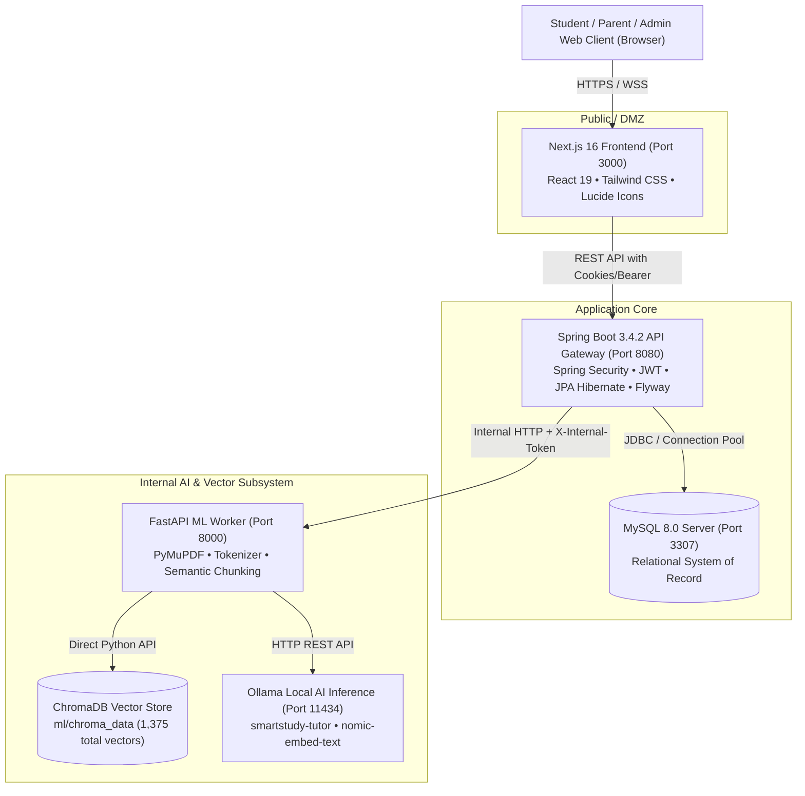
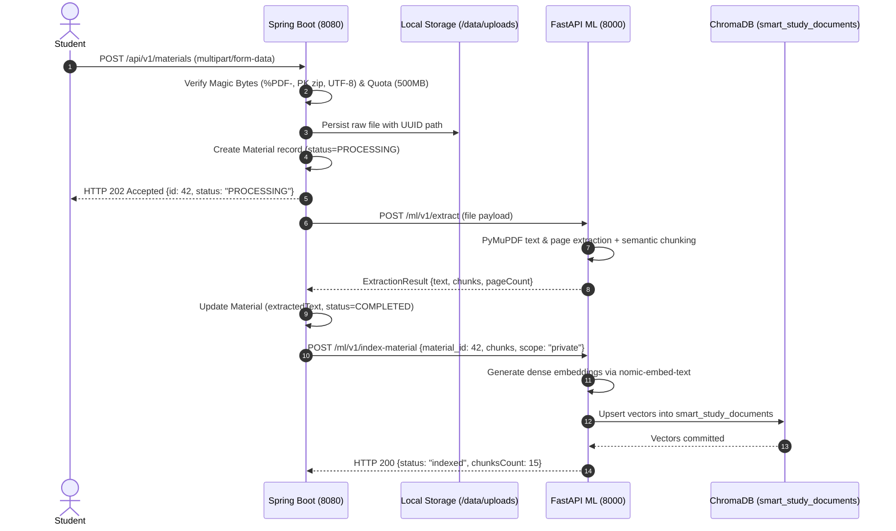
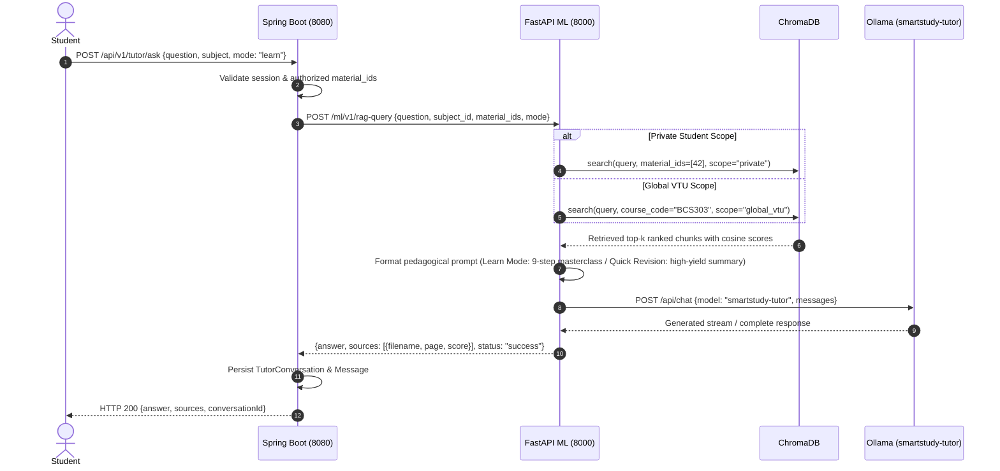

# Smart Study Portal (Smart Edu) — System Architecture Specification

## 1. Executive Summary & Architectural Overview

The **Smart Study Portal (Smart Edu)** is an enterprise-grade, privacy-first educational platform designed for engineering students following the Visvesvaraya Technological University (VTU) curriculum. The platform combines rigorous relational study management (tasks, focus sessions, flashcards, quizzes, adaptive study plans, and parent oversight) with a local-first, zero-cloud-leakage Retrieval-Augmented Generation (RAG) AI Professor.

### Architecture Invariants
1. **Zero Cloud Inference Fallback:** All AI inference (chat generation, embeddings, semantic extraction) executes exclusively on local hardware via Ollama using `smartstudy-tutor` and `nomic-embed-text:latest`. Third-party cloud LLM keys or models injected via request payloads are systematically neutralized.
2. **Fail-Closed Multi-Collection Vector Isolation:** Global VTU curriculum materials reside strictly in `vtu_academic_knowledge` (1,048 vectors across 14 courses). Private student notes reside strictly in `smart_study_documents` (327 vectors). Private queries with empty, missing, or unauthorized `material_ids` fail closed immediately, returning empty lists and preventing cross-tenant chunk leakage.
3. **Relational Truth in MySQL:** MySQL 8 is the immutable system of record for authentication, users, materials metadata, study tasks, adaptive plans, focus sessions, quiz attempts, and parent-student links.
4. **Additive Migrations Only:** Database evolution is strictly managed via Flyway incremental migrations (`V1` through `V11+`). Destructive table drops and resets are forbidden in production.

---

## 2. High-Level Component Architecture

---

## 3. Security Boundaries & Network Segmentation

| Component | Port | Network Boundary | Authentication Mechanism | Allowed Inbound Traffic |
|---|---|---|---|---|
| **Next.js Web Frontend** | 3000 | Public Internet / DMZ | Public / Static Assets | End users (Browsers) |
| **Spring Boot Gateway** | 8080 | Application Gateway | JWT (`study_session` cookie / Bearer token) | Next.js Reverse Proxy / Public API |
| **FastAPI ML Service** | 8000 | Internal Cluster Network | `X-Internal-Token` Header (`dev-internal-token-change-me`) | Spring Boot Gateway ONLY |
| **MySQL Database** | 3307 (or 3306 in Docker) | Isolated Internal Network | Native MySQL Password Auth (`root` / `smart_study`) | Spring Boot Gateway ONLY |
| **ChromaDB Vector Store** | N/A (Embedded) | Local Filesystem (`ml/chroma_data`) | Process-level file ownership (FastAPI) | FastAPI ML Service ONLY |
| **Ollama Local AI** | 11434 | Loopback / Internal Network | Host binding (`127.0.0.1`) | FastAPI ML Service ONLY |

---

## 4. End-to-End Data & Execution Flows

### 4.1 Document Ingestion & Vector Indexing Flow

### 4.2 Grounded AI Tutor Query Flow (Learn & Quick Revision Modes)

---

## 5. Storage Architecture & Relational Schema

### 5.1 Relational Tables (MySQL)
- `users`: Core account data, roles (`STUDENT`, `PARENT`, `ADMIN`), BCrypt work factor 12 password hashes, timezone (`Asia/Kolkata`), email verification status, and `token_version` for instant session revocation.
- `materials`: Uploaded document metadata, UUID storage paths, MIME types, processing status (`UPLOADED`, `PROCESSING`, `COMPLETED`, `FAILED`), and extracted summary.
- `material_chunks`: Relational mirror of chunk text, ordinal, and page boundaries.
- `study_tasks`: Relational task tracking, estimated minutes, priorities (`LOW`, `MEDIUM`, `HIGH`), scheduled dates, status (`PENDING`, `COMPLETED`), and completion timestamps.
- `study_plans`: Adaptive study plans with daily minute budgets (`availableMinutesPerDay`), start/end dates, and status (`ACTIVE`, `SUPERSEDED`).
- `focus_sessions`: Pomodoro and focus timer tracking with `started_at`, `active_since`, `ended_at`, `duration_seconds`, and status (`ACTIVE`, `PAUSED`, `COMPLETED`).
- `quizzes`: Generated assessment containers, titles, and questions JSON schema.
- `quiz_attempts`: Student submissions with score, total questions, and answers JSON.
- `flashcards`: Spaced repetition cards with SuperMemo SM-2 parameters (`ease_factor`, `interval_days`, `review_count`, `lapses`, `next_review`).
- `flashcard_reviews`: Complete audit trail of SM-2 reviews tracking interval and ease factor transitions.
- `tutor_conversations` & `tutor_messages`: AI Tutor chat history, role (`USER`, `TUTOR`), content, and citations.
- `parent_student_links`: Explicit student consent gating (`parent_id`, `student_id`, `status: PENDING|APPROVED|REJECTED`).

### 5.2 Vector Collections (ChromaDB)
- `vtu_academic_knowledge` (1,048 vectors):
  * Strictly global VTU curriculum notes across 14 indexed subjects.
  * Metadata: `course_code`, `subject_id`, `subject_name`, `page_number`, `source_filename`, `verification_status`.
- `smart_study_documents` (327 vectors):
  * Strictly private student uploads.
  * Mandatory query allowlist: searches without a valid positive `material_id` fail closed with `[]`.

