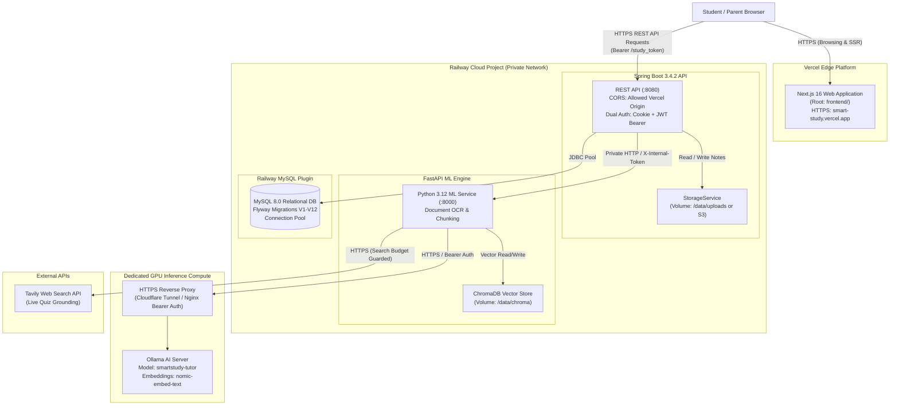

# Smart Study Portal — Vercel + Cloud Production Deployment Guide

**Target Architecture:**
- **Frontend:** Next.js 16 (React 19, TypeScript, Tailwind CSS 4) hosted on **Vercel** (`frontend` directory).
- **Backend & ML Services:** Spring Boot 3.4.2 API, FastAPI ML Engine, MySQL 8.0, and ChromaDB hosted on **Railway**.
- **AI Inference:** Separately hosted, secured Ollama-compatible GPU inference node.

---

## 1. System Architecture Diagram



---

## 2. Prerequisites Checklist

Before beginning deployment, ensure you have:
1. **GitHub Repository:** Pushed code on branch `main` or `production-hardening` to your GitHub account.
2. **Vercel Account:** Free or Pro account at [vercel.com](https://vercel.com).
3. **Railway Account:** Free or Pro account at [railway.com](https://railway.com).
4. **GPU Host:** An active GPU compute instance (RunPod, Modal, Vast.ai, or a dedicated VPS with NVIDIA GPU) running Ollama.
5. **Tavily API Key (Optional):** Free account at [tavily.com](https://tavily.com) for Live Web Research quizzes.

---

## 3. Step 1: Provision Railway Infrastructure

### 3.1 Create a Railway Project
1. Log in to [Railway](https://railway.com).
2. Click **New Project** -> **Empty Project**.
3. Name your project `Smart Study Portal Production`.

### 3.2 Provision Railway MySQL Database
1. In your project canvas, click **New** -> **Database** -> **Add MySQL**.
2. Railway creates a managed MySQL 8.0 instance.
3. Click on the MySQL card -> **Variables** tab:
   - Note the connection variables: `MYSQL_DATABASE`, `MYSQL_USER`, `MYSQL_PASSWORD`, `MYSQLHOST`, `MYSQLPORT`.
   - The private connection string is `${{MySQL.DATABASE_URL}}`.

---

## 4. Step 2: Deploy Spring Boot Backend on Railway

### 4.1 Add Backend Service
1. In the project canvas, click **New** -> **GitHub Repo**.
2. Select your repository.
3. In **Settings**:
   - **Root Directory:** Set to `/backend`.
   - **Build:** Select **Dockerfile** (Railway automatically detects `backend/Dockerfile`).
   - Click **Add Volume**:
     - **Mount Path:** `/data/uploads`
     - **Volume Size:** 5 GB (adjust based on storage quota needs).

### 4.2 Configure Backend Environment Variables
In the Backend Service -> **Variables** tab, add:

```env
# Database
SPRING_DATASOURCE_URL=jdbc:mysql://${{MySQL.MYSQLHOST}}:${{MySQL.MYSQLPORT}}/${{MySQL.MYSQL_DATABASE}}?useSSL=false&allowPublicKeyRetrieval=true&serverTimezone=UTC
SPRING_DATASOURCE_USERNAME=${{MySQL.MYSQLUSER}}
SPRING_DATASOURCE_PASSWORD=${{MySQL.MYSQLPASSWORD}}

# Security & CORS
JWT_SECRET=GENERATE_64_HEX_CHAR_SECRET_HERE
COOKIE_SECURE=true
WEB_ORIGIN=https://YOUR_VERCEL_APP_URL.vercel.app

# Internal ML Service Communication
ML_SERVICE_URL=http://ml.railway.internal:8000
ML_INTERNAL_TOKEN=GENERATE_32_CHAR_SECRET_TOKEN_HERE

# Storage
STORAGE_BACKEND=local
UPLOAD_DIR=/data/uploads

# AI Inference (Point to your GPU Ollama Host)
OLLAMA_BASE_URL=https://ollama.your-gpu-host.com
OLLAMA_CHAT_MODEL=smartstudy-tutor
OLLAMA_EMBED_MODEL=nomic-embed-text
```

### 4.3 Generate a Public Domain for Backend
1. Go to **Settings** -> **Networking** -> **Generate Domain**.
2. Railway generates a public HTTPS domain:  
   `https://smart-study-backend-production.up.railway.app`
3. Save this URL for Step 4 (Frontend configuration).

---

## 5. Step 3: Deploy FastAPI ML Service on Railway

### 5.1 Add ML Service
1. In the Railway canvas, click **New** -> **GitHub Repo**.
2. Select the same repository.
3. In **Settings**:
   - **Service Name:** Rename to `ml` (so internal private networking resolves to `ml.railway.internal`).
   - **Root Directory:** Set to `/ml`.
   - **Build:** Select **Dockerfile** (Railway automatically detects `ml/Dockerfile`).
   - Click **Add Volume**:
     - **Mount Path:** `/data/chroma`
     - **Volume Size:** 5 GB (adjust based on vector index size).

### 5.2 Configure ML Environment Variables
In the ML Service -> **Variables** tab, add:

```env
# Cluster Auth (Must match ML_INTERNAL_TOKEN in backend)
ML_INTERNAL_TOKEN=GENERATE_32_CHAR_SECRET_TOKEN_HERE

# Persistent Vector Store
CHROMA_PERSIST_DIR=/data/chroma

# GPU Ollama Host
OLLAMA_BASE_URL=https://ollama.your-gpu-host.com
OLLAMA_CHAT_MODEL=smartstudy-tutor
OLLAMA_EMBED_MODEL=nomic-embed-text
OLLAMA_CONTEXT_SIZE=8192
OLLAMA_TIMEOUT=120

# Optional: Remote Ollama Bearer Token (if your proxy requires it)
# OLLAMA_API_KEY=YOUR_OLLAMA_PROXY_TOKEN

# Live Web Research
TAVILY_API_KEY=tvly-YOUR_KEY_HERE
TAVILY_DAILY_CREDIT_BUDGET=50

# Document Processing
OCR_ENABLED=true
OCR_LANGS=eng
```

*Note: The ML service does NOT need a public domain. It is accessed exclusively by Spring Boot via Railway's private network at `http://ml.railway.internal:8000`.*

---

## 6. Step 4: Deploy Next.js Frontend on Vercel

### 6.1 Import Project to Vercel
1. Log in to [Vercel](https://vercel.com).
2. Click **Add New...** -> **Project**.
3. Import your GitHub repository.

### 6.2 Configure Project Settings
In the Vercel project configuration screen:
- **Framework Preset:** Next.js
- **Root Directory:** Click **Edit** and select `frontend`.
- **Build Command:** `npm run build` (Turbopack)
- **Output Directory:** `.next`
- **Install Command:** `npm install`

### 6.3 Configure Environment Variables
Under **Environment Variables**, add:

| Key | Value | Environment |
|---|---|---|
| `NEXT_PUBLIC_API_BASE_URL` | `https://smart-study-backend-production.up.railway.app/api/v1` | Production, Preview, Development |
| `NEXT_PUBLIC_DEMO_MODE` | `false` | Production |

### 6.4 Deploy
Click **Deploy**. Vercel will install dependencies, run TypeScript checks, and generate static pages in ~45 seconds.

### 6.5 Update Backend CORS Whitelist
Once Vercel assigns your production domain (e.g. `https://smart-study-portal.vercel.app`):
1. Return to the Railway Backend Service -> **Variables**.
2. Update `WEB_ORIGIN` to include your exact Vercel production URL:
   ```env
   WEB_ORIGIN=https://smart-study-portal.vercel.app
   ```
3. Railway automatically redeploys Spring Boot with the new CORS configuration.

---

## 7. Step 5: Ollama Production GPU Inference Setup

To achieve sub-second token streaming and reliable RAG reasoning, Ollama must run on compute with a modern GPU (e.g., NVIDIA T4, RTX 3090, RTX 4090, A10G, or L4).

### Option A: RunPod / Modal / Vast.ai Serverless or Pod (Recommended)
1. Launch an NVIDIA GPU instance with Ubuntu 22.04.
2. Install Ollama:
   ```bash
   curl -fsSL https://ollama.ai/install.sh | sh
   ```
3. Pull the required models:
   ```bash
   ollama pull nomic-embed-text
   ollama pull qwen2.5:3b
   ```
4. Build the custom academic tutor model from the repository's `ml/Modelfile.tutor`:
   ```bash
   ollama create smartstudy-tutor -f Modelfile.tutor
   ```

### Securing the Remote Inference Endpoint with Cloudflare Tunnel
Never expose raw port 11434 to the open internet without authentication.
1. Install `cloudflared`:
   ```bash
   curl -L --output cloudflared.deb https://github.com/cloudflare/cloudflared/releases/latest/download/cloudflared-linux-amd64.deb
   sudo dpkg -i cloudflared.deb
   ```
2. Create an authenticated tunnel pointing to `http://localhost:11434`.
3. In Cloudflare Access or Nginx reverse proxy, enforce a Bearer token or Service Token.
4. Set `OLLAMA_BASE_URL` in the FastAPI ML environment to your Cloudflare domain (e.g. `https://ollama.yourdomain.com`) and provide `OLLAMA_API_KEY`.

---

## 8. Database Migrations & Verification

When Spring Boot boots on Railway, Flyway executes automatically:
```
[INFO] Flyway Community Edition 10.x by Redgate
[INFO] Database: jdbc:mysql://mysql.railway.internal:3306/smart_study
[INFO] Successfully validated 12 migrations (execution time 00:00.045s)
[INFO] Current version of schema `smart_study`: 12
[INFO] Schema `smart_study` is up to date. No migration necessary.
```

### Manual Verification of Schema Health:
You can verify the backend health directly via:
```bash
curl -s https://smart-study-backend-production.up.railway.app/api/v1/health | jq .
```
Expected output:
```json
{
  "status": "UP",
  "service": "smart-study-api",
  "version": "0.1.0",
  "database": "UP",
  "timestamp": "2026-11-01T15:00:00Z"
}
```

---

## 9. Backup and Recovery Procedures

### 9.1 Relational Database (MySQL)
**Automated Backups:** Railway provides daily automated database snapshots.

**Manual Backup:**
```bash
mysqldump -h mysql.railway.internal -u smart_study -p smart_study > smart_study_prod_backup_$(date +%Y%m%d).sql
```

**Restore:**
```bash
mysql -h mysql.railway.internal -u smart_study -p smart_study < smart_study_prod_backup_YYYYMMDD.sql
```

### 9.2 Vector Database (ChromaDB)
The vector store is persisted on Railway Persistent Volume `/data/chroma`.
To back up:
1. In Railway CLI or volume management:
   ```bash
   tar -czvf chroma_backup_$(date +%Y%m%d).tar.gz /data/chroma
   ```
2. If the Chroma volume is ever corrupted, recreate the indexes by calling the Spring Boot administrative re-index endpoint or uploading study materials.

### 9.3 Student Documents (Uploads)
Persisted on `/data/uploads`.
To back up:
```bash
tar -czvf uploads_backup_$(date +%Y%m%d).tar.gz /data/uploads
```

---

## 10. Deployment Readiness Checklist

- [x] Frontend builds cleanly with zero TypeScript errors (`npm run build`).
- [x] Frontend has 0 hardcoded `localhost:8080` references.
- [x] Frontend centralizes on `NEXT_PUBLIC_API_BASE_URL`.
- [x] Zero secret API keys exist in frontend client bundles.
- [x] Dual authentication transport implemented (Cookie + `Authorization: Bearer`).
- [x] Backend multi-stage Dockerfile builds with non-root security.
- [x] Backend dynamically binds to `${PORT}` for Railway compatibility.
- [x] Backend Actuator and `/api/v1/health` endpoints respond cleanly.
- [x] Storage abstraction supports Railway Volumes and S3/R2 object storage.
- [x] All 12 Flyway SQL migrations validate against MySQL 8.0.
- [x] ML service multi-stage Dockerfile builds with required OCR libraries.
- [x] ML service reads dynamic `${PORT}` and uses `/health` endpoint.
- [x] ChromaDB persists to `/data/chroma`.
- [x] Ollama client supports configurable remote GPU endpoints with bearer token auth.
- [x] Tavily Live Web Research includes daily budget and search rate limits.
- [x] GitHub Actions CI workflow validates builds across all three tiers.

